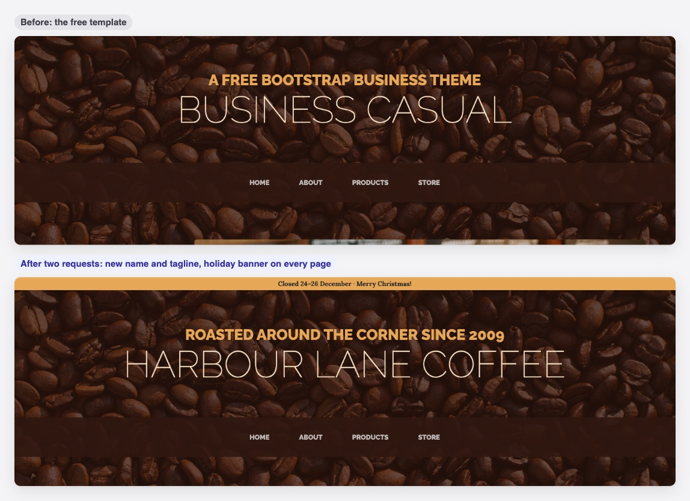
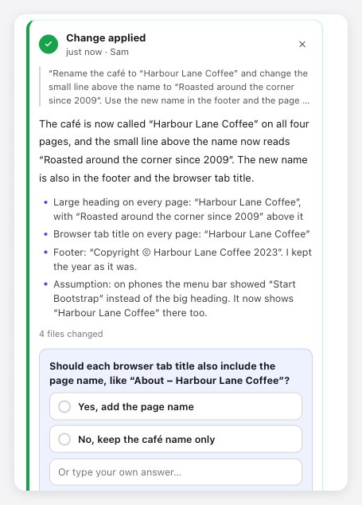
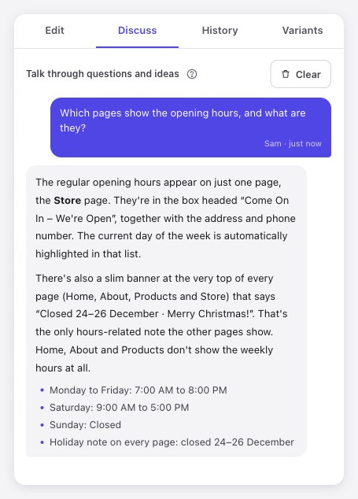
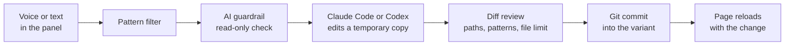

<div align="center">


# SayAndShape

**Change your website by saying what you want.**<br>
A self-hosted panel for static and PHP sites. Describe a change by voice or text; an AI coding agent
(Claude Code or Codex) makes it in a safe copy, every change is checked, committed and can be undone.

[Use cases](#use-cases) · [Screenshots](#screenshots) · [How it works](#how-it-works) · [Install](#install) · [Docs](#documentation)


</div>

## Why

Small changes to a website ("new opening hours", "make that button green", "add a banner for the
holidays") usually mean a ticket for a developer or a CMS the site doesn't have. With SayAndShape
the people who own the site make those changes themselves, right on the page they are looking at,
and nobody has to fear breaking it:

- **Talk to the page.** Speak or type the change in a panel on the live site. No CMS, no build step.
- **Nothing breaks for good.** Every change is a Git commit. Undo any single change, reset, or set a new baseline.
- **Try before it goes live.** Variants are full copies at `/w/<name>/`. Experiment in parallel, then merge into the live site.
- **Checked three times.** A pattern filter and an AI guardrail check the request; a diff review checks the result before it is published.
- **Yours.** Runs on your server with your Claude or Codex account. The project's own files stay untouched; nothing is pushed anywhere.
- **English or German.** Switch the interface in the settings. The AI answers in whatever language you ask in.

## Use cases

| Who | What they say |
|---|---|
| **Small businesses** keeping their own site current | "Change Saturday's opening hours to 9 to 2." · "Add a banner: closed 24–26 December." · "Put the new seasonal latte on the products page." |
| **Agencies and freelancers** handing a site to a client | The client makes everyday edits in a variant; the agency looks at `/w/client-edits/` and merges what is good. Every change carries the name of the person who made it. |
| **Designers and product teams** exploring ideas | "Switch the accent color to a deep forest green." in variant `green`, a different layout in variant `wide`; compare them side by side and keep the winner. |
| **Live sessions and workshops** | Change the page while everybody watches, by voice, and undo with one click if the idea doesn't work. |
| **Content editors on the go** | Dictate a correction from the phone instead of waiting for a laptop. |
| **Accessibility and polish** | "Give all product images a meaningful alt text." · "Increase the contrast of the body text." |
| **Anyone who inherited a site** | Ask in **Discuss** first, nothing is changed: "Which pages show the opening hours?" · "Where does the contact form send its mail?" |

## Screenshots

The demo site is the free [Business Casual](https://github.com/StartBootstrap/startbootstrap-business-casual)
theme by Start Bootstrap (MIT). Every change below was made through the panel by Claude Code, each in
well under a minute; nothing was edited by hand.



Two requests: *"Rename the café to “Harbour Lane Coffee” and change the small line above the name to
“Roasted around the corner since 2009”. Use the new name in the footer and the page titles too."* and
*"Add a slim banner at the very top of every page: “Closed 24–26 December · Merry Christmas!”"*

<table>
<tr>
<td width="50%" valign="top">

<p><b>Result card.</b> The agent says what it changed in plain words and asks when something is open. Answers are one click; an unclear request changes nothing and only asks.</p>
</td>
<td width="50%" valign="top">

<p><b>History.</b> One entry per change, with who asked for it. Undo a single change, discard everything since the baseline, or pin a new baseline. Undo is locked, with the reason, while a later change depends on it.</p>
</td>
</tr>
<tr>
<td width="50%" valign="top">

<p><b>Variants.</b> "Switch the orange accent color to a deep forest green" ran in the variant <i>Green</i> at <code>/w/green/</code>; the live site stayed orange. Merge into “main” when it's good.</p>
</td>
<td width="50%" valign="top">

<p><b>Discuss.</b> Ask about the site without changing anything: <i>"Which pages show the opening hours, and what are they?"</i></p>
</td>
</tr>
<tr>
<td width="36%" valign="top">

<p><b>Settings.</b> Interface language, AI agent (Claude Code or Codex), model and effort, for all projects of the installation.</p>
</td>
<td width="64%" valign="top">

<p><b>English or German.</b> One setting switches the panel, login, setup page and messages. The AI replies in the language of each request.</p>
</td>
</tr>
</table>

## How it works



1. A small router in the project inserts the panel into the pages, for logged-in browsers only.
   Visitors see the site as before.
2. A request becomes a job in a file queue. One job per variant at a time; different variants run in
   parallel.
3. The worker checks the request (pattern filter, then a read-only AI guardrail against the
   project's rules), copies the variant into a temporary working copy and lets the agent edit it there.
4. The diff review compares the result with the starting commit: blocked files, symlinks,
   dangerous patterns, too many files. Only a clean result is committed and published.
5. The panel reloads the page. The change is now one entry in **History** and can be undone on its own.

More detail: [AGENTS.md](AGENTS.md) (configuration, routing, permissions, safety) and
[orchestrator/README.md](orchestrator/README.md) (jobs, rollback rules, tests).

## Install

**Let an AI coding agent do it.** On the machine that serves the site, give Claude Code or Codex this:

> Install SayAndShape from https://github.com/alexohlei/SayAndShape for the project in
> `/path/to/project` (address: `https://example.org`). Clone the repository and follow INSTALL.md
> in it step by step.

**Or by hand**, six commands. [INSTALL.md](INSTALL.md) explains each step and how to check it:

```sh
gh repo clone alexohlei/SayAndShape /var/www/SayAndShape     # outside every document root
cd /var/www/SayAndShape
bin/sayandshape init && bin/sayandshape doctor                # finds claude/codex, asks which to use
bin/sayandshape add /var/www/my-site --url https://example.org --server apache   # or nginx, php
bin/sayandshape passwd --generate
bin/sayandshape daemon start                                  # on servers: bin/sayandshape service
bin/sayandshape check my-site --url https://example.org
```

Then open `https://example.org/sayandshape/login/`. The project gets a three-line
`sayandshape-router.php` and, on Apache, one block in `.htaccess`; `bin/sayandshape remove my-site`
takes both out again. One engine serves any number of projects.

### Requirements

| | |
|---|---|
| Host | Linux or macOS with Bash, Git and `jq` |
| PHP | 8.1 or newer; Apache with `mod_rewrite`, Nginx with PHP-FPM, or `php -S` |
| Python | 3.9 or newer, standard library only |
| AI agent | [Claude Code](https://docs.anthropic.com/en/docs/claude-code) (`claude`) or [Codex](https://github.com/openai/codex) (`codex`), signed in or with an API key |

### What it works with

| Project | |
|---|---|
| Static sites (HTML, CSS, JS, images), in a domain root or a sub-folder | ✅ |
| Plain PHP sites (pages are `.php` files, includes, sessions) | ✅ |
| Several sites or sub-sites on one server | ✅ one engine for all |
| Apps that route every URL through their own front controller (WordPress, Laravel, …) | ❌ |
| Sites with a build step (Vite, Astro, Hugo) or their own server process (Node, Django) | ❌ |

## Documentation

| | |
|---|---|
| [INSTALL.md](INSTALL.md) | Installation step by step, with a check after every step. Written for AI agents, works for people. |
| [AGENTS.md](AGENTS.md) | Reference: configuration, login, routing, variants, permissions, safety checks. |
| [orchestrator/README.md](orchestrator/README.md) | Job lifecycle, rollback rules, recovery, regression tests. |
| [UPGRADE.md](UPGRADE.md) | Moving an existing installation to a new version. |

<details>
<summary><b>Repository layout</b></summary>

```text
Your project                  SayAndShape
sayandshape-router.php        bin/sayandshape   CLI: init, agent, add, remove, language, passwd, daemon, check, doctor
  (3 lines, generated)        install.sh        fetch the engine, first checks
.htaccess block (Apache)      router/router.php front controller: engine routes, variants, panel injection
                              login/index.php   engine login (/sayandshape/login/)
  /sayandshape/login/         setup/index.php   project setup (/sayandshape/setup/)
  /sayandshape/api/*          api/              login, queue, status, history, variants, discuss, setup
                                i18n.php        German texts for the PHP side (English is the key)
  /sayandshape/widget/*       widget/           the panel (sayandshape-widget.js / .css)
  /w/{variant}/*              orchestrator/
                                worker.py       dispatcher, jobs, temporary copies, publication, recovery
                                registry.py     variants and their Git facts
                                i18n.py         German texts for worker messages and commit subjects
                                safety/         prompt filter, diff review
                                git/            commit, rollback, reset
                                tests/          worker, API, panel, safety, Git, installation
                              config/apps.json  projects, language and agent settings (created by init)
                              config/auth.json  password hash (created by passwd)
                              .agent-keys.json  optional API key of the AI agent (created by agent)
                              jobs/             file queue and locks
                              docs/             logo and the screenshots in this README
                              clones/<project>/<variant>/   one Git repository per variant
```

</details>

<details>
<summary><b>Login and permissions</b></summary>

Everything except the public pages requires a login. The login is shared: everyone who may edit uses
the same password, or the project's own admin session (`--auth host`). The panel asks for a display
name, which is stored with every job and commit, so the history shows who changed what.

Temporary working copies are not an operating-system sandbox: the agent runs with the permissions
of the worker's user. Run the worker as a user that can write the engine's `jobs/` and `clones/`
but nothing else of value. Details in [AGENTS.md](AGENTS.md).

</details>

<details>
<summary><b>Tests</b></summary>

Regression tests use temporary repositories and simulated agents; they make no model calls.
Commands are in [orchestrator/README.md](orchestrator/README.md#tests-temporary-repositories-and-local-test-servers-only).

</details>

## License

[MIT](LICENSE)
