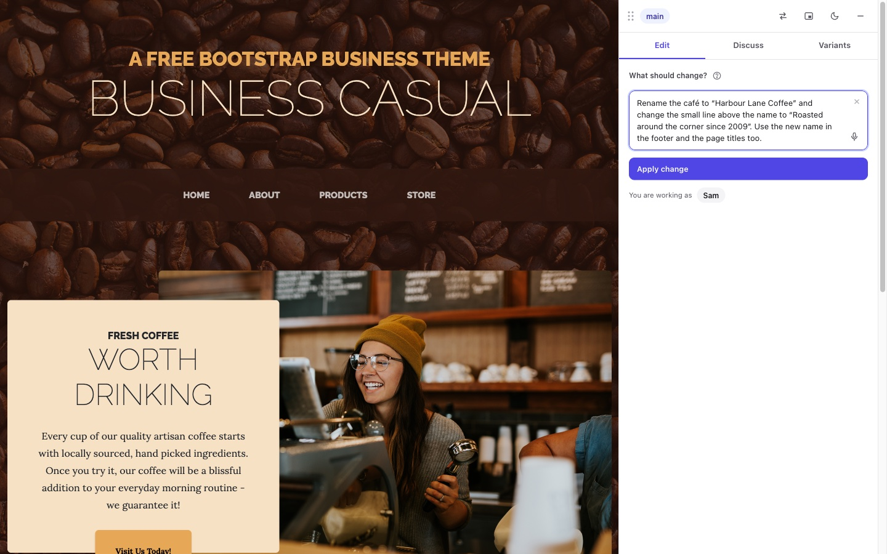
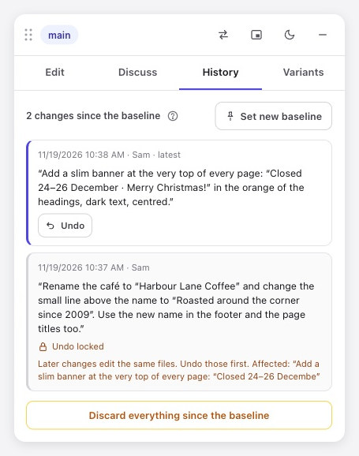
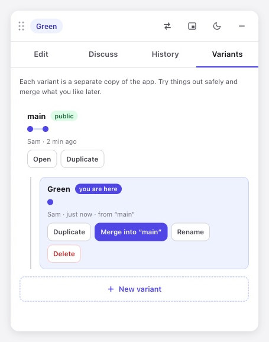
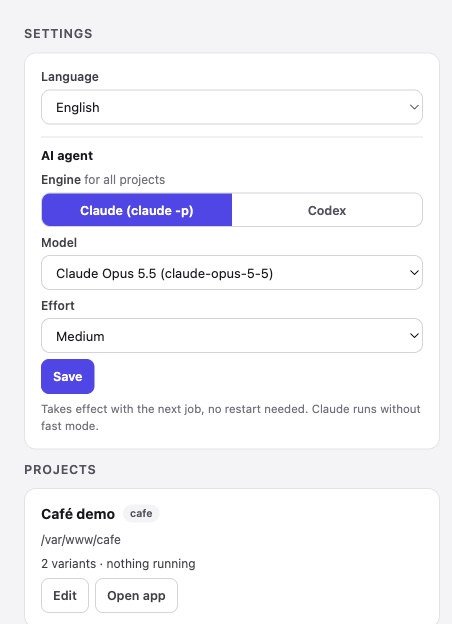
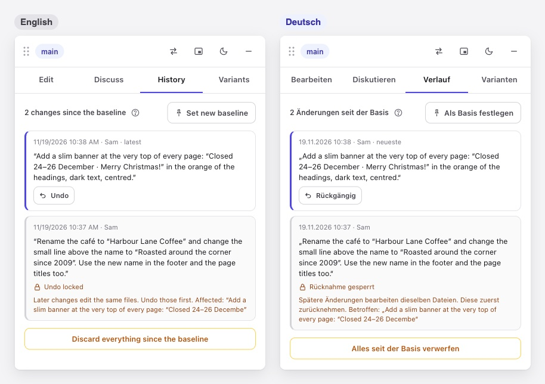
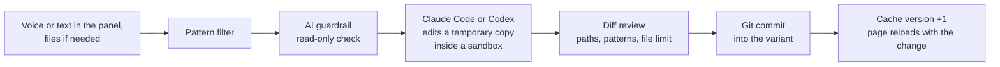

<div align="center">


# SayAndShape

**Change your website by saying what you want.**<br>
A self-hosted panel for static and PHP sites. Describe a change by voice or text; an AI coding agent
(Claude Code or Codex) makes it in a safe copy, every change is checked, committed and can be undone.

[Install](#install) · [Use cases](#use-cases) · [Screenshots](#screenshots) · [How it works](#how-it-works) · [Safety](#safety) · [Docs](#documentation)



</div>

## Install

**1. Open Claude Code (or Codex) in the folder of your published website**, on the machine that serves it:

```sh
cd /var/www/my-site && claude
```

**2. Paste this.** Nothing in it needs to be changed:

```text
Install SayAndShape for the website in this folder: https://github.com/alexohlei/SayAndShape

This folder is the published project folder of the site. Clone the repository to a place
outside the web root and follow its INSTALL.md step by step. Work out the site's address
and web server from this machine's configuration, and ask me only for what you cannot
find out yourself.
```

**3. Log in** at the address the agent gives you, `https://your-site/sayandshape/login/`, with the
password it shows you once. A round **Edit** button appears at the bottom right of every page.

The agent looks up the site's address and web server itself, puts the engine next to the web root,
connects the site, starts the worker and checks the result. Your pages are not edited: the site gets
a three-line `sayandshape-router.php` and, on Apache, one block in `.htaccess`.

> [!WARNING]
> **SayAndShape lets an AI agent change files on your server.** Run it in an isolated environment,
> ideally a container or a small VM that holds only the sites it may edit, and keep the agent's
> sandbox switched on. Please read [Safety](#safety) before you install it on a machine that matters.
>
> The sandbox is **on by default**: the agent can change and delete files of the site it is working
> on and nothing else on the server. [How it works and how to switch it off](#the-agent-sandbox).

### By hand

Six commands instead of the prompt. [INSTALL.md](INSTALL.md) explains each step and how to check it:

```sh
gh repo clone alexohlei/SayAndShape /var/www/SayAndShape     # outside every document root
cd /var/www/SayAndShape
bin/sayandshape init && bin/sayandshape doctor                # finds claude/codex, asks which to use
bin/sayandshape add /var/www/my-site --url https://example.org --server apache   # or nginx, php
bin/sayandshape passwd --generate
bin/sayandshape daemon start                                  # on servers: bin/sayandshape service
bin/sayandshape check my-site --url https://example.org
```

Then open `https://example.org/sayandshape/login/`. `bin/sayandshape remove my-site` takes the router
file and the `.htaccess` block out again. One engine serves any number of projects.

<details>
<summary><b>Requirements</b></summary>

| | |
|---|---|
| Host | Linux or macOS with Bash, Git and `jq` |
| PHP | 8.1 or newer; Apache with `mod_rewrite`, Nginx with PHP-FPM, or `php -S` |
| Python | 3.9 or newer, standard library only |
| AI agent | [Claude Code](https://docs.anthropic.com/en/docs/claude-code) (`claude`, 2.1.257 or newer) or [Codex](https://github.com/openai/codex) (`codex`), signed in or with an API key |
| Agent sandbox | built in on macOS; on Linux, Claude Code needs `bubblewrap` and `socat` (`apt install bubblewrap socat`) |

</details>

<details>
<summary><b>What it works with</b></summary>

| Project | |
|---|---|
| Static sites (HTML, CSS, JS, images), in a domain root or a sub-folder | ✅ |
| Plain PHP sites (pages are `.php` files, includes, sessions) | ✅ |
| Several sites or sub-sites on one server | ✅ one engine for all |
| Apps that route every URL through their own front controller (WordPress, Laravel, …) | ❌ |
| Sites with a build step (Vite, Astro, Hugo) or their own server process (Node, Django) | ❌ |

</details>

## Why

Small changes to a website ("new opening hours", "make that button green", "add a banner for the
holidays") usually mean a ticket for a developer or a CMS the site doesn't have. With SayAndShape
the people who own the site make those changes themselves, right on the page they are looking at,
and nobody has to fear breaking it:

- **Talk to the page.** Speak or type the change in a panel on the live site. No CMS, no build step.
- **Bring your files.** Drop photos, a logo or a PDF onto the panel; the agent puts them where they belong on the site.
- **Nothing breaks for good.** Every change is a Git commit. Undo any single change, reset, or set a new baseline.
- **Try before it goes live.** Variants are full copies at `/w/<name>/`. Experiment in parallel, then merge into the live site.
- **Checked three times, fenced in once.** A pattern filter and an AI guardrail check the request, the agent works in a sandbox that lets it write to a copy of the site and nowhere else, and a diff review checks the result before it is published.
- **No stale pages.** Every published change counts the site's cache version up, so browsers load the new styles, scripts and images right away.
- **Yours.** Runs on your server with your Claude or Codex account. The project's own files stay untouched; nothing is pushed anywhere.
- **English or German.** Switch the interface in the settings. The AI answers in whatever language you ask in.

## Use cases

| Who | What they say |
|---|---|
| **Small businesses** keeping their own site current | "Change Saturday's opening hours to 9 to 2." · "Add a banner: closed 24–26 December." · "Put the new seasonal latte on the products page." · Drop a photo and the new menu as a PDF onto the panel: "Use the photo on the start page and link the menu below it." |
| **Agencies and freelancers** handing a site to a client | The client makes everyday edits in a variant; the agency looks at `/w/client-edits/` and merges what is good. Every change carries the name of the person who made it. |
| **Designers and product teams** exploring ideas | "Switch the accent color to a deep forest green." in variant `green`, a different layout in variant `wide`; compare them side by side and keep the winner. |
| **Live sessions and workshops** | Change the page while everybody watches, by voice, and undo with one click if the idea doesn't work. |
| **Content editors on the go** | Dictate a correction from the phone instead of waiting for a laptop. |
| **Accessibility and polish** | "Give all product images a meaningful alt text." · "Increase the contrast of the body text." |
| **Anyone who inherited a site** | Ask in **Discuss** first, nothing is changed: "Which pages show the opening hours?" · "Where does the contact form send its mail?" |

## Screenshots

The demo site is the free [Business Casual](https://github.com/StartBootstrap/startbootstrap-business-casual)
theme by Start Bootstrap (MIT). Every change below was made through the panel by Claude Code, each in
well under a minute; nothing was edited by hand.


Two requests: *"Rename the café to “Harbour Lane Coffee” and change the small line above the name to
“Roasted around the corner since 2009”. Use the new name in the footer and the page titles too."* and
*"Add a slim banner at the very top of every page: “Closed 24–26 December · Merry Christmas!”"*

<table>
<tr>
<td width="50%" valign="top">

<p><b>Result card.</b> The agent says what it changed in plain words and asks when something is open. Answers are one click; an unclear request changes nothing and only asks.</p>
</td>
<td width="50%" valign="top">

<p><b>Discuss.</b> Ask about the site without changing anything: <i>"Which pages show the opening hours, and what are they?"</i></p>
</td>
</tr>
<tr>
<td width="50%" valign="top">

<p><b>History.</b> One entry per change, with who asked for it. Undo a single change, discard everything since the baseline, or pin a new baseline. Undo is locked, with the reason, while a later change depends on it.</p>
</td>
<td width="50%" valign="top">

<p><b>Variants.</b> "Switch the orange accent color to a deep forest green" ran in the variant <i>Green</i> at <code>/w/green/</code>; the live site stayed orange. Merge into “main” when it's good.</p>
</td>
</tr>
<tr>
<td width="50%" valign="top">

</td>
<td width="50%" valign="middle">
<p><b>Settings.</b> Interface language, AI agent (Claude Code or Codex), model and effort, for all projects of the installation.</p>
</td>
</tr>
<tr>
<td colspan="2">

<p><b>English or German.</b> One setting switches the panel, login, setup page and messages. The AI replies in the language of each request.</p>
</td>
</tr>
</table>

## How it works



1. A small router in the project inserts the panel into the pages, for logged-in browsers only.
   Visitors see the site as before.
2. A request becomes a job in a file queue. One job per variant at a time; different variants run in
   parallel. Files dropped onto the panel (images, documents, styles; no server code) travel with the
   request, and the agent copies them to where they belong on the site.
3. The worker checks the request (pattern filter, then a read-only AI guardrail against the
   project's rules), copies the variant into a temporary working copy and lets the agent edit it there.
   The agent runs in its own sandbox: it may change and delete files in that copy, but it cannot write
   anywhere else on the server and has no network access.
4. The diff review compares the result with the starting commit: blocked files, symlinks,
   dangerous patterns, too many files. Only a clean result is committed and published.
5. The variant's cache version counts up and the panel reloads the page. The router versions the
   page's stylesheets, scripts and images with it and their change times (`site.css?v=12-1795185311`), so nobody keeps looking at an old
   file. The change is now one entry in **History** and can be undone on its own.

More detail: [AGENTS.md](AGENTS.md) (configuration, routing, permissions, safety) and
[orchestrator/README.md](orchestrator/README.md) (jobs, rollback rules, tests).

## Safety

SayAndShape turns a sentence into file changes on a server, carried out by an AI coding agent. Several
layers keep that inside the site: the login, the pattern filter, the AI guardrail, the agent's
sandbox and the diff review. They lower the risk; they cannot remove it. A language model can misread
a request, and a request can be written to mislead it. So set things up for the day one layer fails.

**Give it a home of its own.** Run the web server, the engine and the worker in a container or a
small virtual machine (Docker, Podman, LXC, a cheap VPS) that holds only the sites people may edit.
No other customers' sites, no databases you cannot afford to lose, no SSH keys, cloud credentials or
backups within reach. Let the worker run as its own unprivileged user without `sudo`. If something
does go wrong, the damage ends at the container wall and you rebuild it.

**Keep the agent's sandbox on.** It is on by default and keeps the agent inside the working copy
of a change; see [The agent sandbox](#the-agent-sandbox) below for what it does and how to switch it.

**Give Claude or Codex only what the job needs.** Use a dedicated API key or account with a spending
limit, not a personal login that opens other doors. Keep the worker user's agent configuration
plain: no MCP servers, plugins, hooks or extra writable folders. Keep the CLI up to date.

**Say what may be changed.** `allowed_changes` describes the editable surface in one sentence,
`extra_blocked_files` protects files such as `.env` or `config.php`, `max_files_per_change` limits
the size of a change, `upload_types` names the kinds of files people may attach to a request (server
code such as PHP is never among them; all in [AGENTS.md](AGENTS.md)). Serve the login over HTTPS and choose a strong
password: everyone who has it can give the agent instructions.

**Keep backups** of the project folder and of `clones/` somewhere the server cannot reach.

Two limits to know about. Reading is fenced in less tightly than writing: Codex can read whatever the
worker user can read, so keep secrets out of that user's reach. And a page the agent writes runs
later with the rights of the web server, like any other page of the site, which is one more reason
for the container. SayAndShape is MIT-licensed software and comes without warranty.

### The agent sandbox

While it edits, Claude Code or Codex runs in the operating-system sandbox of its own CLI. Nothing
has to be set up for that on macOS; on Linux, Claude Code needs `bubblewrap` and `socat`
(`apt install bubblewrap socat`).

| With the sandbox on (default) | |
|---|---|
| Change and delete files in the working copy of the change | ✅ |
| Write anywhere else on the server (other sites, the engine, the home folder, system files) | ❌ |
| Network access (downloads, calls to other systems) | ❌ |
| Read outside the working copy | ❌ with Claude Code; Codex can read what the worker user can |

If the sandbox cannot start, a change request fails instead of running unprotected, and
`bin/sayandshape doctor` says what is missing.

```sh
bin/sayandshape agent                 # shows the agent in use and "sandbox on" or "sandbox OFF"
bin/sayandshape agent --sandbox off   # switch it off
bin/sayandshape agent --sandbox on    # switch it back on (the default)
```

The switch takes effect with the next change request; the worker does not need a restart. It is
stored as `"sandbox": false` under `agent` in `config/apps.json` and can only be changed on the
server's command line, not in the browser, so nobody can switch it off with the login password alone.

**Switch it off only where something else is the fence:** inside a container or VM that holds
nothing but the sites to edit, typically because a sandbox cannot be started inside that container.
Without it the agent has every permission of the worker's user: it can read, change and delete
whatever that user can, and reach the network. `bin/sayandshape doctor` shows a warning for as long
as it is off.

## Documentation

| | |
|---|---|
| [INSTALL.md](INSTALL.md) | Installation step by step, with a check after every step. Written for AI agents, works for people. |
| [AGENTS.md](AGENTS.md) | Reference: configuration, login, routing, variants, permissions, safety checks. |
| [orchestrator/README.md](orchestrator/README.md) | Job lifecycle, rollback rules, recovery, regression tests. |
| [UPGRADE.md](UPGRADE.md) | Moving an existing installation to a new version. |

<details>
<summary><b>Repository layout</b></summary>

```text
Your project                  SayAndShape
sayandshape-router.php        bin/sayandshape   CLI: init, agent, add, remove, language, passwd, daemon, check, doctor
  (3 lines, generated)        install.sh        fetch the engine, first checks
.htaccess block (Apache)      router/router.php front controller: engine routes, variants, panel injection
                              login/index.php   engine login (/sayandshape/login/)
  /sayandshape/login/         setup/index.php   project setup (/sayandshape/setup/)
  /sayandshape/api/*          api/              login, queue, uploads, status, history, variants, discuss, setup
                                i18n.php        German texts for the PHP side (English is the key)
  /sayandshape/widget/*       widget/           the panel (sayandshape-widget.js / .css)
  /w/{variant}/*              orchestrator/
                                worker.py       dispatcher, jobs, temporary copies, publication, recovery
                                registry.py     variants and their Git facts
                                i18n.py         German texts for worker messages and commit subjects
                                safety/         prompt filter, diff review
                                git/            commit, rollback, reset
                                tests/          worker, API, panel, safety, Git, installation
                              config/apps.json  projects, language and agent settings (created by init)
                              config/auth.json  password hash (created by passwd)
                              .agent-keys.json  optional API key of the AI agent (created by agent)
                              jobs/             file queue, locks and files uploaded with a request
                              docs/             logo and the screenshots in this README
                              clones/<project>/<variant>/   one Git repository per variant
```

</details>

<details>
<summary><b>Login and permissions</b></summary>

Everything except the public pages requires a login. The login is shared: everyone who may edit uses
the same password, or the project's own admin session (`--auth host`). The panel asks for a display
name, which is stored with every job and commit, so the history shows who changed what.

While it edits, the agent runs in the sandbox of its CLI and can write only to the working copy of
the change (see [Safety](#safety)). Still run the worker as a user that can write the engine's
`jobs/` and `clones/` but nothing else of value. Details in [AGENTS.md](AGENTS.md).

</details>

<details>
<summary><b>Tests</b></summary>

Regression tests use temporary repositories and simulated agents; they make no model calls.
Commands are in [orchestrator/README.md](orchestrator/README.md#tests-temporary-repositories-and-local-test-servers-only).

</details>

## License

[MIT](LICENSE)
